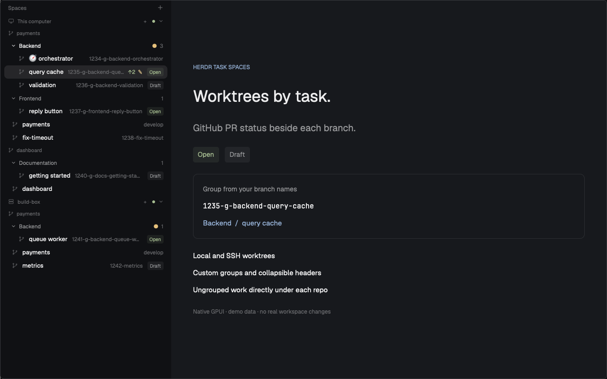

# Herdr Task Spaces

Group Herdr worktrees by repository and task, with **Draft/Open/Merged GitHub PR badges**
beside each branch. Keep ordinary workspaces directly under their repo, collapse
named groups, and keep the same spaces, terminals, and menus.



## What it does

- Groups by **machine → repository → task group**. Machines and repos stay separate.
- Reads group membership from branch names; custom groups need no registration.
- Shows **Draft**, **Open**, **Merged**, or **PR ?** with the PR number and URL in a tooltip.
- Supports local and SSH worktrees, fork PRs, group folding, and a compact rail.
- Keeps ungrouped workspaces one level up, without an Ungrouped header.
- Does not rename branches, move worktrees, or create spaces to enforce grouping.

No dependency on Annotator, a particular repository, or an issue tracker.

## Install

Requires Herdr App, herdr-core (`hc`), Git 2.31+, and Python 3. Tested with
Herdr App 0.1.12 on macOS. The installer and mod also target Linux; live Linux
rendering has not been checked. PR badges optionally use local GitHub CLI (`gh`)
authenticated with `gh auth login`. Missing `gh` does not block the sidebar.

```sh
git clone https://github.com/jakub-tucek/herdr-task-spaces.git
cd herdr-task-spaces
herdr-app do layout.clone '{"name":"main","as":"my-task-groups"}'
python3 scripts/install.py --layout my-task-groups
```

Already have a personal layout? Pass its name instead. The installer replaces
only that layout's stock Spaces reference, leaving its other panels and props
alone. It backs up changes, rejects shipped layouts, and refuses to overwrite
an existing mod without a matching receipt or after local edits.

For a name collision, use `--name my-task-spaces`. `HERDR_APP_HOME` selects a
different app home. To copy the mod without changing any layout, omit `--layout`.

To stop using it, switch back with `herdr-app do layout.switch '{"name":"main"}'`.
Terminals keep running. Keep the clone to return to this view later.

## Optional: teach your AI the grouping convention

The mod reads branch names; it does not teach your agent how to create them.
The bundled [herdr-task-spaces skill](skills/herdr-task-spaces/SKILL.md) covers
branch naming, group selection and inheritance, orchestrators, and safe local/SSH
worktree creation. The mod installer does **not** install this skill or change
your agent configuration.

From this repository directory, copy it to a skill directory your agent supports.
This example uses `~/.agents/skills`; change `skill_dir` if your agent uses a
different global or project-local location:

```sh
skill_dir="$HOME/.agents/skills/herdr-task-spaces"
if [ -e "$skill_dir" ] || [ -L "$skill_dir" ]; then
  printf 'Skill already exists at %s; compare it before updating.\n' "$skill_dir"
else
  mkdir -p "$(dirname "$skill_dir")"
  cp -R skills/herdr-task-spaces "$skill_dir"
fi
```

Reload your agent's skills or start a new session, then ask:

> Use herdr-task-spaces to create a worktree for issue 1234 in the backend group.

The skill respects explicit branch names and repository rules, asks for missing
issue numbers, and creates an App space or starts an agent only when requested.
If you already use another worktree-management skill, check their naming rules
for conflicts before enabling both. Updates are manual: compare the installed
skill with the bundled version; the command above never overwrites it.

## Branch names

```text
1234-g-backend-orchestrator   → Backend / 🧭 orchestrator
1235-g-backend-query-cache    → Backend / query cache
1236-g-frontend-reply-button  → Frontend / reply button
1237-fix-timeout              → directly under the repo
```

The format is `<issue_number>-g-<group>-<task>`: digits, one lowercase alphanumeric
group key, and a lowercase kebab-case task. Numbers are labels, not integrations.
Use your own ticket number. The exact task `orchestrator` sorts first; other tasks
sort naturally. Existing names and full branch refs remain unchanged.

Branches without the marker, main/develop, and detached HEAD stay directly under
the repository. Nothing guesses a group from a task name. Old Ungrouped fold
state cannot hide these rows.

## Configure without editing code

Edit the Spaces node's `content` in your **personal layout**, keeping its existing
node ID, sizes, and other fields:

```json
{
  "mod": "task-spaces",
  "props": {
    "github": true,
    "groups": [
      { "key": "backend", "label": "Backend" },
      { "key": "frontend", "label": "Frontend" },
      { "key": "docs", "label": "Documentation" }
    ]
  }
}
```

`groups` sets labels and order, not an allowlist. Other branch-defined groups
still appear in natural order; empty groups stay hidden. An empty array uses
natural order for every group. Invalid configuration falls back to the defaults
in `groups.js`. Omit `groups` to use those example defaults.

Set `github` to `false` to disable PR metadata, including the extra remote reads.
Fold state is scoped per machine, repository, and group.

## Network, permissions, and refresh

Automatic checks are read-only. Git runs on each checkout's machine. The mod
runs local `hc machine ls` and queries **github.com only** using local `gh`, even
for SSH worktrees. No GitHub credentials are sent to remote hosts.

PR lists are cached for five minutes and shared across worktrees in the same
base repo. The last successful result remains visible for five extra minutes
during refresh or brief GitHub failures, without a refreshing label. Failed
attempts never extend that grace period; after ten minutes without success,
status becomes PR ?. A successful refresh replaces the old result immediately.
The cache is in memory and does not survive mod reloads or app restarts.
Reads run serially, stop after 500 open and 500 recently updated closed
PRs, and distinguish unknown status
from no PR. Fork matches include head repo and branch. If one branch has several
PRs, Open takes precedence over Draft, then Merged; the tooltip notes additional
matches. Long-lived `develop`, `main`, and `master` branches never show Merged;
their active Open/Draft badges still appear. Closed-but-unmerged PRs have no badge.
When the repository-wide list hits its limit without a reliable match, an exact
head-branch lookup checks both open and closed PRs. Results, including confirmed
absence, share the same cache and grace period across worktrees. Confirmed no PR
shows no badge; a failed or still-truncated branch lookup shows PR ?.

This mod has its own monitoring, separate from Annotator: one filesystem watch
per local Git directory, an inherited 250 ms scheduling check, 15-second machine
refresh, and a 60-second foreground Git fallback. PR refresh uses that scheduler,
not another watcher or daemon. Cached badges can lag GitHub by five minutes.

Right-click menus and explicit row actions retain Herdr's normal space controls.
The mod stores fold state locally; it ships no workspace IDs or private repo data.

## Development

Node.js 22+ for JavaScript tests; Python 3 for installer and optional skill-setup
tests. No npm dependencies.

```sh
npm test
python3 -m unittest discover -s tests -v
herdr-app check mods/task-spaces
```

See [RECIPE.md](RECIPE.md) for the build brief. Screenshot fixtures use synthetic
data and do not start terminals or query GitHub.
On macOS, regenerate the native 1280 × 800 preview with
`python3 scripts/screenshot.py`. It opens and closes only its own temporary demo
overlay and blocks workspace actions, settings writes, and program execution.

## License

[Apache-2.0](LICENSE). Adapted from Herdr App's Spaces mod; see [NOTICE](NOTICE).
