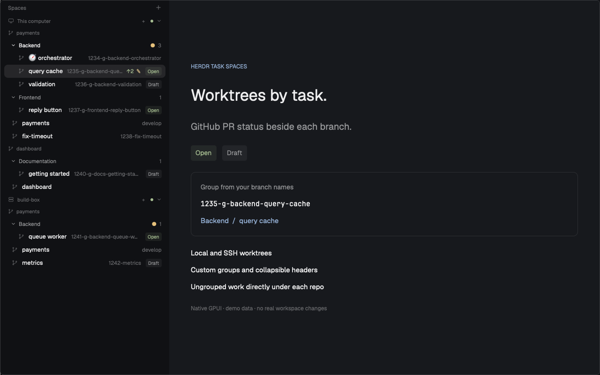

# Herdr Task Spaces

Organize Herdr worktrees by repository and branch-defined task groups. See Draft
Open, and Merged GitHub PR badges beside each workspace, keep ungrouped workspaces directly
under their repo, and collapse groups without moving or renaming your work.

## What you see

- A native Spaces sidebar that replaces the stock Spaces mod in a personal layout.
- Machine headers, repository headers, and optional named task-group headers.
- Workspace rows with their existing names or readable task slugs, Git ahead/behind
  and dirty indicators, and a small gray Draft, green Open, or purple Merged PR badge.
- PR ? for unavailable or stale metadata. Hover for the number, URL, or explanation.
- Ungrouped rows directly under their repo, not inside a category. Orchestrators
  appear first with a compass; custom groups require no registration.
- Theme colors, 28–30 px workspace rows, compact numbered navigation below a
  160 px sidebar width, and the existing right-click menus and drag interactions.

## How it behaves

Branch format: `<issue_number>-g-<group>-<task>`, for example
`1234-g-backend-query-cache`. The group is one lowercase alphanumeric token and
the task lowercase kebab-case. The exact task `orchestrator` sorts first.
Other tasks sort naturally. Names without the marker stay ordinary rows.

Keep machines and Git common directories separate. A repo's main checkout need
not be open. Collapse only named groups; persist folds by machine/repo/group.
Do not interpret branch changes as permission to move spaces or rename refs.

Use optional layout `props.groups` for group labels/order and `props.github=false`
to disable PR reads. Unknown groups still appear. Use only the person's own live
spaces and panes, never bundled workspace assignments.

Show GitHub PR status for the current head repository and branch. Read origin
and upstream on the checkout's own machine; query GitHub using local gh on the
app machine. Support github.com only. Match forks correctly. Cache for five
minutes across worktrees; serialize reads and cap pagination at 500 open and 500
recently updated closed PRs. Only merged closed PRs get a badge. Unknown status
must not look like no PR. If multiple PRs match, prefer Open over Draft over Merged.
Suppress Merged for develop, main, and master; keep active PR badges on those branches.
Retain the last successful result during refresh or brief GitHub failures for
five minutes beyond its five-minute TTL. Show no refreshing label. After ten
minutes without success show PR ?; failed attempts must not extend the grace.

Preserve normal blocked/done/working indicators. Optional PR failures must not
interrupt Git refresh or navigation. Never post, resolve, fetch, stage, commit,
or message an agent automatically.

## Built from

- `mods/task-spaces/main.js`: native GPUI sidebar and the original Spaces refresh,
  menus, selection, and rail behavior, modified for grouping and PR badges.
- `groups.js`: parsing, scoped display model, ordering, configuration, fold keys.
- `pull-requests.js`: remote identities, per-repo caching, PR matching, pagination.
- `props()`, `spaces()`, `panes()`, `machines()`, `layout()`, theme/shared state,
  native file watches, local hc, read-only Git, and local gh.
- Icons referenced from the existing shipped `workspace-chrome` mod, not bundled.
- Python installer with receipts, backups, local-edit detection, alternate mod
  names, and optional replacement of stock Spaces in a personal layout only.

## Watch out

This runs programs and makes authenticated read-only GitHub requests. Disclose
that before installing. It needs Herdr App and core; no standalone TUI watcher.
Do not edit shipped mods/layouts or use this author's local paths or workspace IDs.

The inherited 250 ms scheduler does not run Git every tick. Git checks follow
completion, directory changes, watches, and a foreground fallback. Machines poll
every 15 seconds. PR freshness is five minutes, not real-time; there is no extra
PR watcher. Keep local/SSH identities and credentials separate.

The standalone mod folder alone does not replace a panel. Use a personal layout
or clone one first. Refuse unknown installs, symlinks, and locally modified copies.
Never reset saved settings or stop terminals during install or removal.

## Done when

JavaScript and installer tests pass; native check passes; the native demo shows
groups, direct ungrouped rows, Draft/Open badges, and a compact rail. Tests cover
custom configuration, forks, multiple machines, TTL, pagination, unavailable gh,
and local/remote adapter routing. Demo captures contain no personal data and make
no GitHub calls or real workspace/terminal changes.
